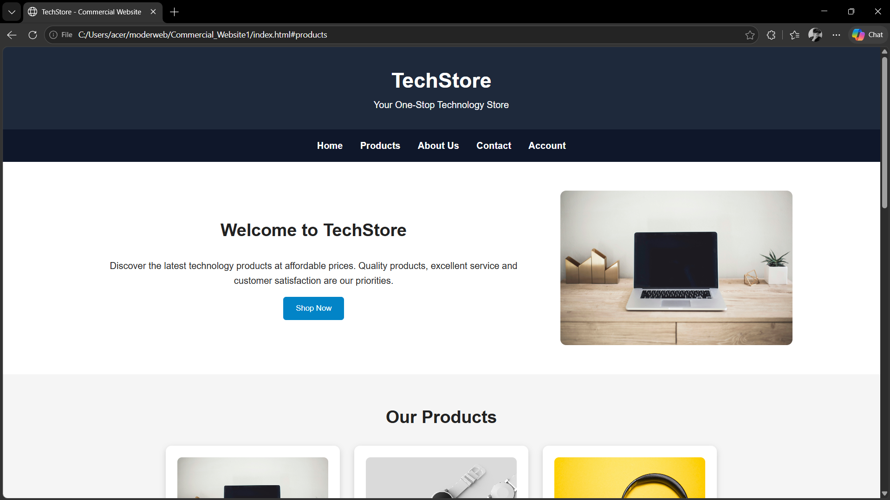

# Ex02 Commercial Website
## Date:31.10.2026

## AIM
To create a commercial website using CSS Flexbox.

## ALGORITHM
### STEP 1
Create an HTML file (index.html)

### STEP 2
Create a CSS file (style.css)

### STEP 3
Include a navigation bar with links to different sections.

### STEP 4
Add structured sections for Homepage, Products / Services, About Us, Contact Details and User Account.

### STEP 5
Include social media links at the footer with copyright information.

### STEP 6
Define global styles for fonts, colors, and layout.

### STEP 7
Style the header, navigation bar, and sections.

### STEP 8
Use Flexbox for layout design.

### STEP 9
Add hover effects and transitions for interactivity.

### STEP 10
Add Images and Media.

### STEP 11
Use optimized images for a professional look.

### STEP 12
Open the HTML file in a browser to check layout and functionality.

### STEP 13
Fix styling issues and refine content placement.

### STEP 14
Deploy the website.

### STEP 15
Upload to GitHub Pages for free hosting.

## PROGRAM

## index.html
```
<!DOCTYPE html>
<html lang="en">
<head>
    <meta charset="UTF-8">
    <meta name="viewport" content="width=device-width, initial-scale=1.0">
    <title>TechStore - Commercial Website</title>

    <!-- CSS File -->
    <link rel="stylesheet" href="style.css">
</head>

<body>

    <!-- Header -->
    <header>
        <h1>TechStore</h1>
        <p>Your One-Stop Technology Store</p>
    </header>

    <!-- Navigation Bar -->
    <nav>
        <a href="#home">Home</a>
        <a href="#products">Products</a>
        <a href="#about">About Us</a>
        <a href="#contact">Contact</a>
        <a href="#account">Account</a>
    </nav>

    <!-- Home Section -->
    <section id="home" class="home">
        <div>
            <h2>Welcome to TechStore</h2>
            <p>
                Discover the latest technology products at affordable prices.
                Quality products, excellent service and customer satisfaction
                are our priorities.
            </p>
            <button>Shop Now</button>
        </div>

        
    </section>

    <!-- Products Section -->
    <section id="products">
        <h2>Our Products</h2>

        <div class="products">

            <div class="product">
                
                <h3>Laptop</h3>
                <p>High-performance laptops for work and study.</p>
                <h4>₹55,000</h4>
                <button>Buy Now</button>
            </div>

            <div class="product">
                
                <h3>Smart Watch</h3>
                <p>Modern smart watches with advanced features.</p>
                <h4>₹4,999</h4>
                <button>Buy Now</button>
            </div>

            <div class="product">
                
                <h3>Headphones</h3>
                <p>Enjoy high-quality sound with wireless headphones.</p>
                <h4>₹2,499</h4>
                <button>Buy Now</button>
            </div>

        </div>
    </section>

    <!-- About Us Section -->
    <section id="about" class="about">
        <h2>About Us</h2>
        <p>
            TechStore is a modern online technology store providing quality
            electronic products at competitive prices. Our goal is to make
            technology accessible and convenient for everyone.
        </p>
    </section>

    <!-- Contact Section -->
    <section id="contact">
        <h2>Contact Us</h2>

        <div class="contact">
            <div>
                <h3>Address</h3>
                <p>Chennai, Tamil Nadu, India</p>
            </div>

            <div>
                <h3>Email</h3>
                <p>support@techstore.com</p>
            </div>

            <div>
                <h3>Phone</h3>
                <p>+91 98765 43210</p>
            </div>
        </div>
    </section>

    <!-- User Account Section -->
    <section id="account" class="account">
        <h2>User Account</h2>

        <form>
            <input type="text" placeholder="Enter Username">
            <input type="email" placeholder="Enter Email">
            <input type="password" placeholder="Enter Password">
            <button type="submit">Create Account</button>
        </form>
    </section>

    <!-- Footer -->
    <footer>
        <h3>TechStore</h3>

        <div class="social">
            <a href="#">Facebook</a>
            <a href="#">Instagram</a>
            <a href="#">Twitter</a>
            <a href="#">LinkedIn</a>
        </div>

        <p>&copy; 2026 TechStore. All Rights Reserved.</p>
    </footer>

</body>
</html>

```

## index.html
```
/* Global Styles */
* {
    box-sizing: border-box;
    margin: 0;
    padding: 0;
}

body {
    font-family: Arial, sans-serif;
    line-height: 1.6;
    background-color: #f5f5f5;
    color: #222;
}

/* Header */
header {
    background-color: #1e293b;
    color: white;
    text-align: center;
    padding: 30px;
}

header h1 {
    font-size: 36px;
}

/* Navigation */
nav {
    background-color: #0f172a;
    display: flex;
    justify-content: center;
    gap: 30px;
    padding: 15px;
}

nav a {
    color: white;
    text-decoration: none;
    font-weight: bold;
    transition: 0.3s;
}

nav a:hover {
    color: #38bdf8;
}

/* General Sections */
section {
    padding: 50px 10%;
    text-align: center;
}

section h2 {
    margin-bottom: 25px;
    font-size: 30px;
}

/* Home */
.home {
    display: flex;
    align-items: center;
    justify-content: space-between;
    gap: 40px;
    background-color: white;
}

.home div {
    flex: 1;
}

.home img {
    width: 400px;
    max-width: 100%;
    border-radius: 10px;
}

/* Buttons */
button {
    background-color: #0284c7;
    color: white;
    border: none;
    padding: 12px 22px;
    margin-top: 15px;
    border-radius: 5px;
    cursor: pointer;
    transition: 0.3s;
}

button:hover {
    background-color: #0369a1;
    transform: scale(1.05);
}

/* Products */
.products {
    display: flex;
    justify-content: center;
    gap: 25px;
    flex-wrap: wrap;
}

.product {
    background-color: white;
    width: 300px;
    padding: 20px;
    border-radius: 10px;
    box-shadow: 0 3px 10px #ccc;
    transition: 0.3s;
}

.product:hover {
    transform: translateY(-8px);
}

.product img {
    width: 100%;
    height: 180px;
    object-fit: cover;
    border-radius: 8px;
}

.product h3 {
    margin-top: 15px;
}

.product h4 {
    color: #0284c7;
    margin-top: 10px;
}

/* About */
.about {
    background-color: #e0f2fe;
}

/* Contact */
.contact {
    display: flex;
    justify-content: space-around;
    gap: 20px;
    flex-wrap: wrap;
}

.contact div {
    background-color: white;
    padding: 25px;
    width: 250px;
    border-radius: 8px;
}

/* Account */
.account {
    background-color: white;
}

form {
    display: flex;
    flex-direction: column;
    max-width: 400px;
    margin: auto;
    gap: 12px;
}

form input {
    padding: 12px;
    border: 1px solid #aaa;
    border-radius: 5px;
}

/* Footer */
footer {
    background-color: #0f172a;
    color: white;
    text-align: center;
    padding: 30px;
}

.social {
    display: flex;
    justify-content: center;
    gap: 25px;
    margin: 15px;
}

.social a {
    color: white;
    text-decoration: none;
}

.social a:hover {
    color: #38bdf8;
}

/* Responsive Design */
@media (max-width: 768px) {

    nav {
        flex-direction: column;
        align-items: center;
        gap: 10px;
    }

    .home {
        flex-direction: column;
    }

    .home img {
        width: 100%;
    }

    .contact {
        flex-direction: column;
        align-items: center;
    }
}
```


## OUTPUT



## RESULT
The program for creating commercial website using CSS Flexbox is executed successfully.
